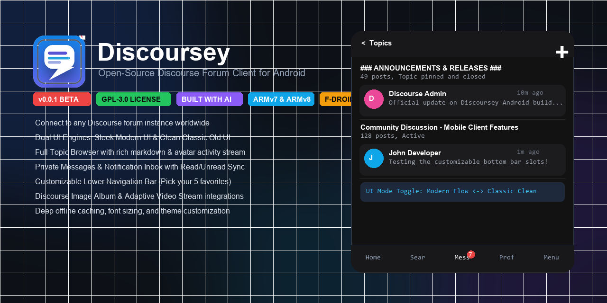

# Discoursey

[-success.svg)](https://github.com/dthirdfatpig/Discoursey/releases)

> 🤖 **AI Creation Notice**: Discoursey is an open-source Android client designed and developed with AI assistance to deliver a fast, customizable experience for Discourse communities worldwide.

**Discoursey** is an open-source, highly customizable native client for Discourse forums. Designed for performance, flexibility, and user choice, Discoursey connects to any public or private Discourse community and supports both a dynamic, modern feed and an ultra-lean, classic reading layout.

📦 **[Download Latest Universal APK & Source Code on GitHub Releases](https://github.com/dthirdfatpig/Discoursey/releases)**

---

## 🌟 General Description & Overview

Discourse powers some of the most vibrant technical and community forums on the web. While standard mobile browser experiences can feel heavy or constrained, Discoursey provides a snappy, native Android experience built using modern Android architecture, Jetpack Compose, OkHttp, and Kotlin Coroutines.

Whether you prefer a rich card-based interface with last-poster activity streams or a minimalist, distraction-free reading experience, Discoursey gives you complete control over your forum browsing.

---

## ⚡ Core Functions & Capabilities

### 1. 🌐 Universal Discourse Connectivity
- **Connect to Any Forum**: Enter your Discourse instance URL (`https://yourcommunity.com`), username, and password or API key.
- **Robust Session Authentication**: Full support for CSRF tokens, session cookie persistence, and password or API key authentication.
- **Built-in Demo Mode**: Test drive features instantly on public communities.

### 2. 🎨 Dual UI Engines
Discoursey comes built-in with two distinct UI layouts:
- **Modern Flow UI**:
  - Full topic title without truncation and status indicators (pinned, closed).
  - Rich activity stream showcasing the last poster's avatar, username, clean message excerpts, and relative timestamps.
  - Pull-to-refresh and real-time floating pill notifying when new topics are available.
  - Quick action floating buttons for composing new topics and immediate replies.
- **Classic Clean UI**:
  - Ultra-clean, compact layout with tight spacing and high readability.
  - Full topic titles always displayed.
  - Instant **"Type to filter"** live search box at the top of topic feeds.
  - Comment counters with compact bubble icons and clean relative timestamps.
  - Pull-to-refresh support.

### 3. 💬 Rich Reactions & Post Interactions
- **Emoji Reactions**: React to posts with the full set of Discourse custom emojis (❤️, 👍, 😂, 😮, 😢, 🚀, 🎉, 🔥) alongside standard likes.
- **Interactive Reaction Chips**: View real-time reaction counts per emoji on each post with active user highlighting.

### 4. 📎 Direct Attachments & Video Streams
- **Direct Image Uploads**: Select photos from your device to upload directly to Discourse (`/uploads.json`) with automated markdown formatting.
- **Video Uploads & Streams**: Upload videos directly to Discourse or seamlessly stream via Cloudflare Stream / Bunny.net using the `discourse-video-stream` plugin.
- **Discourse Photo Album**: Browse and insert pictures from community photo albums.

### 5. 📬 Personal Messages & Notification Inbox
- **Two Dedicated Tabs**:
  - **Private Messages**: View, read, and reply to private discussions with community members.
  - **Notifications**: Real-time listing of mentions, replies, quotes, and badges.
- **Unread Counter Badges**: Visual badge on the navigation bar displaying unread count.
- **1-Tap Sync**: Instantly mark all notifications as read via Discourse's native API.

### 6. 🎛️ Customizable Lower Navigation Bar
Customize the 5 lower navigation buttons to fit your exact habits:
- Map buttons to **Home**, **Search**, **Personal Messages**, **Profile**, **Menu**, **Latest Topics**, **Categories**, or **Bookmarks**.
- Choose from preset configurations or customize individual slots.

### 7. 🛠️ Android & Storage Preferences
- **Username vs Nickname Display**: Choose whether user nicknames (`@handle`) or full names take the primary prominent spot across topics and posts, or let the app automatically follow the forum's configuration.
- **Disk & Image Cache Management**: Inspect real-time storage usage and clear cache with one tap.
- **Configurable Cache Limits**: Restrict storage usage to 50MB, 100MB, 250MB, 500MB, or 1GB.
- **Font Sizing**: Small, Normal, Large, and Extra Large typography options.
- **Color Themes**: Modern Dark, Classic Dark (slate), AMOLED Pure Black, and Clean Light themes.
- **Profile Updates**: Change your display name, bio, and website directly from the app.

---

## 📱 Releases & Architecture

Discoursey is packaged as a single **Universal APK** compatible with all supported Android device architectures (ARMv7, ARMv8/ARM64, x86, and x86_64):

| Package | Architecture | Description |
| :--- | :--- | :--- |
| `app-universal-release.apk` | **Universal** | Single unified package for all modern and legacy Android devices (Android 7.0+). |

Visit the **[Releases Page](https://github.com/dthirdfatpig/Discoursey/releases)** to download the latest build and source code archives.

---

## 📜 Latest Changelog

### [0.0.3-beta] - 2026-11-21

- **Topic Lists & Feed Improvements**:
  - Added pull-to-refresh to both Modern and Classic topic feeds.
  - Added interactive top notification banner that alerts users when new topics are available to tap and reload.
  - Removed redundant top-left navigation back arrow on root home feed.
  - Ensured full topic titles are always displayed in full without truncation in both Modern and Classic UI layouts.
  - Cleaned topic snippet previews to omit empty placeholder messages.
- **Attachment & Media Support**:
  - Added direct file picker and upload support for images via Discourse's native `/uploads.json` endpoint.
  - Added video upload support with automated fallback to direct upload or Cloudflare/Bunny video streaming via `discourse-video-stream`.
  - Added native inline rendering for post image attachments and video streams.
- **Emoji Reactions**:
  - Added interactive Discourse emoji reactions (❤️, 👍, 😂, 😮, 😢, 🚀, 🎉, 🔥) alongside standard likes.
  - Added reaction counter chips on posts with interactive toggling and active selection states.
- **User Display Customization**:
  - Added preference setting to prioritize nicknames (`@username`) or full names, respecting forum defaults (`enable_names`).
- **Classic UI Tuning**:
  - Tightened spacing and row padding to deliver an ultra-clean, compact reading experience.
  - Streamlined relative timestamp formatting across all views.
- **Packaging**:
  - Consolidated build artifacts into a single unified Universal APK for streamlined installation and distribution.
